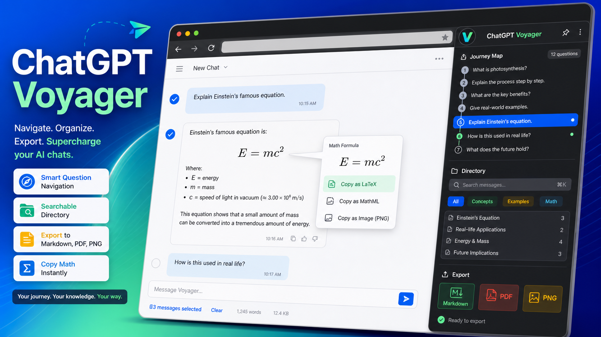

# ChatGPT Voyager



面向 ChatGPT 网页端的浏览器扩展，让长对话更容易查找、整理、导出和复用公式。适用于 Chrome、Edge 等 Chromium 浏览器，目前仅支持 [chatgpt.com](https://chatgpt.com/)。

## 主要功能

- **问题目录**：搜索、跳转用户问题，查看回答的一句话概览；目录自动更新，面板可调整尺寸。
- **内容导出**：选择问题清单或已加载的对话，复制或下载 Markdown，也可导出 PDF、PNG。
- **公式复制**：提供 Word UnicodeMath、WPS LaTeX、Markdown LaTeX 和原始 LaTeX 四种格式。
- **本地整理**：用文件夹保存会话链接，管理提示词和基础设置。文件夹、提示词和设置保存在当前浏览器本地。

## 安装

1. 从 [Releases](https://github.com/121209/chatgpt-voyager/releases) 下载扩展 ZIP 并解压，也可直接使用克隆或解压后的源码目录。
2. 打开 Chrome 的 `chrome://extensions/` 或 Edge 的 `edge://extensions/`，开启“开发者模式”。
3. 点击“加载已解压的扩展程序”，选择包含 `manifest.json` 的目录（不是 ZIP 文件）。
4. 打开或刷新 ChatGPT 对话页。

更新扩展后，在扩展管理页点击“重新加载”，再刷新 ChatGPT 页面。

## 使用

### 查找问题

点击或悬停右侧官方问题导航附近的 Voyager 菜单入口，打开“目录”。输入关键词筛选问题，点击条目跳转；拖动面板边缘或四角可调整尺寸。右侧问题横线及其跳转由 ChatGPT 官方导航提供。

长对话中若有问题缺失，可滚动经过历史内容或点击“深度采集”。插件也会同步官方导航中可读取的问题标题；尚未加载的历史问题可能需要先找回位置才能跳转。

### 导出内容

打开“导出”标签页，选择模式、勾选条目，再点击导出按钮。可用“全选”或“清空”调整范围。

| 模式 | 导出范围 |
| --- | --- |
| 问题（默认） | 目录中已记录的问题清单；PDF、PNG 同样导出清单本身 |
| 对话 | 当前页面已加载的用户和助手消息，不包含尚未加载的历史回复 |

Markdown 可复制到剪贴板或下载为 `.md`；PDF 通过浏览器打印预览保存；PNG 生成图片并下载。对话 PDF 会尽量保留代码块和公式结构，PNG 需要当前活动标签页的截图权限，内容过长时请分批导出。

### 复制公式

悬停公式或选中公式文本，打开“复制公式”工具条并选择格式：

| 格式 | 用法 |
| --- | --- |
| Word UnicodeMath | 在 Word 中按 `Alt+=` 打开公式编辑器后粘贴 |
| WPS LaTeX | 用于 WPS 的 LaTeX 公式输入 |
| Markdown LaTeX | 复制带行内或块级分隔符的 LaTeX |
| 原始 LaTeX | 复制去除外围分隔符的 LaTeX |

### 管理文件夹与提示词

点击浏览器工具栏中的插件图标，可新建、删除文件夹，将当前会话保存到文件夹，并调整基础设置。点击其中的 `Options` 可新增或删除提示词；提示词库目前仅提供本地管理，暂不支持页面内一键插入。

## 当前限制

- ChatGPT 页面结构变化可能影响目录、跳转和公式识别。
- 长对话的已记录问题不等于完整对话正文；导出前请确认模式、识别数量和选择范围。
- 公式复制依赖页面保留的 LaTeX 或 MathML。缺少可靠源码时可能提示无法转换或回退为文本；复杂公式在 Word/WPS 中仍可能需要手动调整。

## 开发与检查

在源码仓库中运行（需要 Node.js 和 npm）：

```bash
npm install
npm run check       # 回归检查与 JavaScript 语法检查
npm run build       # 执行检查并生成 dist/
```

加载构建产物时，在扩展管理页选择 `dist/`。仅重新打包可运行 `npm run build:dist`。

开发前请阅读 [AGENTS.md](AGENTS.md)，修复记录写入 [REGRESSION_LOG.md](REGRESSION_LOG.md)。验收步骤见[人工测试清单](https://github.com/121209/chatgpt-voyager/blob/main/docs/MANUAL_TEST_CHECKLIST.md)，开发方向见[项目计划](https://github.com/121209/chatgpt-voyager/blob/main/docs/VOYAGER_PLAN.md)。

## 反馈与来源

遇到问题或有功能建议，请提交 [Issue](https://github.com/121209/chatgpt-voyager/issues)。报告问题时请附浏览器和插件版本、操作步骤、预期与实际结果，以及截图；导航问题请注明点击入口和对话大致轮数。

本项目是针对 ChatGPT 的独立实现，功能设计参考 [Nagi-ovo/gemini-voyager](https://github.com/Nagi-ovo/gemini-voyager)。来源说明见 [NOTICE.md](NOTICE.md)。
